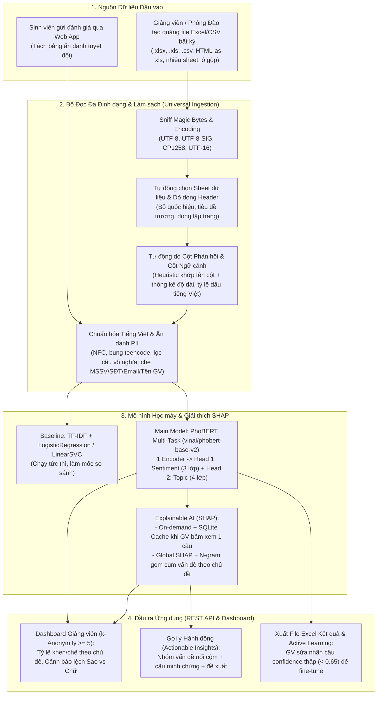

# Spec.md — Hệ thống Phân tích Phản hồi Sinh viên & Gợi ý Cải thiện Chất lượng Đào tạo (VSFC-Feedback-Analyzer)

> **Phiên bản:** 1.0  
> **Cập nhật lần cuối:** 2026-10-28  
> **Bộ dữ liệu gốc:** UIT-VSFC (`uitnlp/vietnamese_students_feedback` — 16,175 phản hồi sinh viên đại học Việt Nam)  
> **Mô hình chính:** `PhoBERT Multi-Task` (1 Encoder + 2 Classification Heads: Sentiment 3 lớp & Topic 4 lớp) + Baseline `TF-IDF + LogisticRegression / LinearSVC / ComplementNB`  
> **Giải thích mô hình (XAI):** `SHAP` (PartitionExplainer theo yêu cầu có cache cho từng câu + SHAP toàn cục trích xuất từ khóa theo chủ đề)  
> **Tính năng đặc biệt:** Bộ đọc đa định dạng & tự động dò cột thông minh (Universal Excel/CSV Ingestion) + Phân quyền 2 vai trò ẩn danh tuyệt đối (Sinh viên / Giảng viên).

---

## 1. Tổng quan hệ thống

**Tên project:** Hệ thống Phân tích Phản hồi Sinh viên & Gợi ý Cải thiện Học phần (`VSFC-Feedback-Analyzer`)  
**Mục tiêu:** Tự động hóa việc đọc, làm sạch, ẩn danh và phân loại hàng chục nghìn câu khảo sát cuối kỳ của sinh viên đại học Việt Nam theo **Cảm xúc (Sentiment)** và **Chủ đề (Topic)**; giải thích nguyên nhân dự đoán bằng **SHAP**; đồng thời tổng hợp thành các **Gợi ý hành động cụ thể (Actionable Insights)** cho Giảng viên và Phòng Đào tạo.  
**Người dùng chính:**
1. **Sinh viên (`student`):** Gửi phản hồi môn học ẩn danh trên App (kèm chấm sao Likert 1–5).
2. **Giảng viên (`lecturer`):** Xem Dashboard tổng hợp các môn mình dạy, kiểm tra giải thích SHAP cho từng câu tiêu cực, sửa nhãn (Active Learning) và tải báo cáo Excel.
3. **Phòng Đào tạo / Khoa (`admin`):** Quăng file Excel/CSV khảo sát bất kỳ của trường lên hệ thống, hệ thống tự động nhận diện sheet, dòng tiêu đề, cột văn bản và xuất file kết quả kèm gợi ý cải thiện toàn khoa.

### Luồng hoạt động tổng thể



---

## 2. Bộ dữ liệu Huấn luyện & Kiểm thử

### 2.1 Bộ dữ liệu chuẩn: UIT-VSFC (`uitnlp/vietnamese_students_feedback`)

| Thuộc tính | Chi tiết |
| :--- | :--- |
| **Nguồn** | Nhóm nghiên cứu UIT-NLP — Trường ĐH Công nghệ Thông tin, ĐHQG-HCM |
| **Tổng số bản ghi** | **16,175** câu phản hồi thực tế của sinh viên Việt Nam |
| **Phân chia gốc (Official Split)** | **Train:** 11,426 câu (70.64%) \| **Dev (Validation):** 1,583 câu (9.79%) \| **Test:** 3,166 câu (19.57%) |
| **Thư mục lưu trữ** | `data/raw/{train,dev,test}_{sentences,sentiments,topics}.txt` → ghép thành `data/processed/{train,dev,test}_raw.csv` ở Notebook `00` |

### 2.2 Phân bố nhãn thực tế (Đã kiểm tra trên dữ liệu tải về)

**Nhãn 1 — Cảm xúc (`sentiment`):**

| Mã số | Nhãn chữ | Ý nghĩa | Train (11,426) | Dev (1,583) | Test (3,166) | Đặc điểm & Lưu ý |
| :---: | :--- | :--- | :---: | :---: | :---: | :--- |
| `0` | `negative` | Tiêu cực (Chê / Phàn nàn) | 5,325 (46.60%) | 705 (44.54%) | 1,409 (44.50%) | Chiếm gần một nửa, rất giàu thông tin để rút gợi ý cải thiện |
| `1` | `neutral` | Trung lập | **458 (4.01%)** | **73 (4.61%)** | **167 (5.27%)** | **Mất cân bằng rất nặng (~4–5%)**, ranh giới mờ, dễ bị đoán nhầm sang `0` hoặc `2` |
| `2` | `positive` | Tích cực (Khen ngợi) | 5,643 (49.39%) | 805 (50.85%) | 1,590 (50.22%) | Lớp đa số |

**Nhãn 2 — Chủ đề (`topic`):**

| Mã số | Nhãn chữ | Ý nghĩa | Train (11,426) | Dev (1,583) | Test (3,166) | Đặc điểm & Lưu ý |
| :---: | :--- | :--- | :---: | :---: | :---: | :--- |
| `0` | `lecturer` | Giảng viên (cách dạy, thái độ, tác phong) | **8,166 (71.47%)** | 1,151 (72.71%) | 2,290 (72.33%) | **Áp đảo (> 71%)**, sinh viên chủ yếu nhận xét về thầy cô |
| `1` | `training_program` | Chương trình đào tạo (giáo trình, bài tập, lịch thi, kiến thức) | 2,201 (19.26%) | 267 (16.87%) | 572 (18.07%) | Phổ biến thứ hai |
| `2` | `facility` | Cơ sở vật chất (phòng học, máy chiếu, điều hòa, phòng máy) | **497 (4.35%)** | **70 (4.42%)** | **145 (4.58%)** | Ít mẫu (~4.4%), nhưng từ vựng rất đặc trưng (`máy chiếu`, `nóng`, `phòng máy`) |
| `3` | `others` | Khác (nhận xét chung, không thuộc 3 nhóm trên) | **562 (4.92%)** | **95 (6.00%)** | **159 (5.02%)** | Ít mẫu (~5%), câu thường ngắn hoặc chung chung (`ok`, `tốt`, `không có ý kiến`) |

### 2.3 Bộ dữ liệu Stress-Test thực tế: 10 File Excel/CSV "Bẩn" Giả lập (`data/samples_messy/`)

Để chứng minh hệ thống xử lý mượt khi giảng viên hoặc thầy cô chấm bài quăng bất kỳ bảng Excel khảo sát nào của các trường đại học khác nhau lên, dự án tự sinh **10 file khảo sát giả lập đủ mọi tình huống "khó đỡ" ngoài đời thực** (kèm `ground_truth.json` lưu đáp án dòng header và tên cột nội dung để chấm điểm tự động 10/10):

1. `01_clean.xlsx`: Bảng chuẩn sạch (`STT`, `MSSV`, `Họ tên`, `Ý kiến đóng góp`).
2. `02_title_rows.xlsx`: Có 5 dòng quốc hiệu, tên trường, tên phòng khảo thí ở đầu sheet; dòng tiêu đề thật nằm ở `row 5`; có kèm các cột điểm Likert (1–5).
3. `03_english_cols.xlsx`: Tên cột hoàn toàn bằng tiếng Anh (`ID`, `Course`, `Student_Feedback`, `Rating`).
4. `04_multi_sheet.xlsx`: File có 3 sheet (`HuongDan`, `TongHop`, `DuLieu`), dữ liệu thật nằm ở sheet thứ 3 (`DuLieu`).
5. `05_legacy.xls`: Định dạng Excel 97–2003 (`.xls` nhị phân cũ), tên cột là `Ý kiến khác`.
6. `06_semicolon_bom.csv`: File CSV xuất từ Excel vùng tiếng Việt (mã hóa `UTF-8-SIG` có BOM, dùng dấu chấm phẩy `;` làm phân cách).
7. `07_cp1258.csv`: File CSV mã hóa `Windows-1258` (codepage tiếng Việt cũ của Windows).
8. `08_two_text_cols.xlsx`: Bảng khảo sát tách thành 2 cột văn bản riêng biệt (`Ưu điểm`, `Nhược điểm`) kèm cột điểm số.
9. `09_long_paragraphs.xlsx`: Có ô gộp (`Merged Cells` ở tiêu đề `A1:C1`), dòng tiêu đề lặp lại ở giữa bảng (do xuất từ báo cáo chia trang), mỗi ô chứa đoạn văn dài 2–3 câu ghép lại.
10. `10_html_as_xls.xls`: File mang đuôi `.xls` nhưng bên trong thực chất là bảng `<table>` HTML (rất phổ biến ở các cổng đào tạo đại học Việt Nam đời cũ).

---

## 3. Những Điều Cần Lưu Ý & Hướng Giải Quyết Toàn Diện

Mục này tổng hợp **toàn bộ các vấn đề thực tế, điểm dễ sai và rủi ro** đã thảo luận, kèm giải pháp kỹ thuật cụ thể áp dụng trong cả Notebook lẫn App:

### 3.1 Nhóm vấn đề Dữ liệu & Tiếng Việt

| # | Vấn đề thực tế | Hướng giải quyết trong hệ thống |
| :-: | :--- | :--- |
| **1** | **Lỗi bảng mã & Unicode dựng sẵn vs tổ hợp:** Cùng chữ `"giảng viên"` nhưng gõ bằng bộ gõ khác nhau (`NFC` vs `NFD`) sẽ tạo ra chuỗi byte khác nhau, làm lệch từ vựng của TF-IDF và PhoBERT. | Ép toàn bộ văn bản qua `unicodedata.normalize("NFC", text)` ngay bước đầu tiên; xóa các ký tự zero-width (`\u200b`, `\ufeff`) và ký tự điều khiển. |
| **2** | **Teencode, viết tắt & lặp ký tự của sinh viên:** Sinh viên viết `"gv dạy nhiệt tình lắm lunnnn"`, `"ko hiểu j hết"`, `"phòng học đc"`. | Xây dựng từ điển chuẩn hóa teencode học đường (`gv`→`giảng viên`, `sv`→`sinh viên`, `ko/k/hok/hong`→`không`, `dc/đc`→`được`, `vs`→`với`, `bt`→`bình thường`, `j`→`gì`...) chỉ thay thế khi đứng độc lập theo ranh giới từ `\b`; rút gọn ký tự lặp $\ge 3$ liên tiếp (`"lunnnn"` → `"lunn"`). |
| **3** | **Tách từ tiếng Việt (Word Segmentation) cho PhoBERT:** PhoBERT được huấn luyện trên văn bản đã tách từ ghép bằng dấu gạch dưới (`sinh_viên`, `giảng_viên`). Nếu đưa chữ rời hoặc dùng bộ tách từ quá nặng sẽ lỗi/chậm. | Trong Notebook & App: hỗ trợ tách từ bằng `underthesea.word_tokenize(..., format="text")` hoặc từ điển ghép từ học đường phổ biến để tạo `sentence_seg` riêng cho PhoBERT, trong khi vẫn giữ cột `sentence_clean` cho TF-IDF (dùng kết hợp word n-gram `(1,2)` và char n-gram). |
| **4** | **Câu rỗng / "Không có ý kiến" trong file khảo sát trường:** Khi thu khảo sát bắt buộc, 20–40% sinh viên gõ `"không"`, `"ko có ý kiến"`, `"."`, `"-"`, `"n/a"`, `"ok"`. Nếu đẩy vào model sẽ làm loãng thống kê. | Lọc riêng bằng danh sách `NO_CONTENT` và ngưỡng độ dài tối thiểu (`< 3` ký tự chữ cái). Trên App, các dòng này được gán trạng thái `NO_CONTENT` (đếm riêng tỷ lệ không ý kiến, **không** tính vào mẫu số khen/chê của giảng viên). Lưu ý: khi đánh giá trên tập Test chuẩn của UIT-VSFC (3,166 câu), **không xóa dòng nào** để giữ nguyên số lượng mẫu đối sánh công bằng. |
| **5** | **Một ô Excel chứa đoạn văn nhiều câu, trái chiều nhau:** Ví dụ: *"Thầy dạy rất dễ hiểu và nhiệt tình. Tuy nhiên máy chiếu phòng B204 bị mờ và điều hòa hỏng."* (Câu 1 khen GV, câu 2 chê CSVC). | Tách đoạn văn dài thành từng câu đơn theo dấu câu `[.!?;]\s+|\n+` trước khi đưa vào PhoBERT dự đoán. Mỗi câu nhận 1 cặp nhãn `(sentiment, topic)` riêng, sau đó tổng hợp lại theo dòng gốc (`row_id`) và theo chủ đề của môn học. |

### 3.2 Nhóm vấn đề Đọc File Excel/CSV Đa Định Dạng (Khi Thầy/Cô Quăng File Lạ Lên)

| # | Vấn đề thực tế | Hướng giải quyết trong hệ thống |
| :-: | :--- | :--- |
| **6** | **Đuôi file không khớp ruột file:** Nhiều phần mềm quản lý đào tạo xuất file `.xls` nhưng thực chất bên trong là mã HTML `<table>`, hoặc CSV nhưng lưu đuôi `.txt`. | Không tin vào đuôi file; đọc 8–2048 byte đầu tiên (**Magic Bytes Sniffing**): `PK\x03\x04` → `.xlsx` (`openpyxl`), `\xD0\xCF\x11\xE0` → `.xls` (`xlrd`), `<html`/`<table` → `pd.read_html`, còn lại giải mã văn bản + `csv.Sniffer` tự tìm dấu phân cách (`,`, `;`, `\t`, `\|`). |
| **7** | **File Excel có nhiều Sheet (Sheet bìa, hướng dẫn, thống kê, dữ liệu):** Nếu mặc định đọc sheet đầu tiên (`sheet_name=0`) sẽ đọc nhầm trang bìa. | Quét tất cả sheet không rỗng, chấm điểm từng sheet dựa trên số dòng và số lượng ô chứa chuỗi văn bản dài ($> 15$ ký tự) để tự động chọn đúng sheet dữ liệu (đồng thời cho phép người dùng chọn lại trên UI). |
| **8** | **Dòng tiêu đề (Header) không nằm ở dòng 0 & có Ô gộp (Merged Cells) hoặc lặp lại tiêu đề giữa bảng:** Các biểu mẫu trường luôn có 3–7 dòng tiêu đề "TRƯỜNG ĐẠI HỌC...", "KẾT QUẢ KHẢO SÁT..." ở đầu. | Quét 40 dòng đầu tiên (`header=None`), chấm điểm từng dòng dựa trên: tỷ lệ ô là chữ ngắn ($\le 60$ ký tự), tỷ lệ không rỗng, độ duy nhất giữa các ô, điểm khớp từ khóa tên cột (`ý kiến`, `góp ý`, `mssv`, `môn học`...) và mật độ dữ liệu của 5 dòng kế tiếp. Sau khi cắt bảng, tự động loại bỏ các dòng bên dưới trùng khớp $\ge 50\%$ với tên cột (dòng lặp tiêu đề khi sang trang). |
| **9** | **Tên cột mỗi trường một kiểu hoặc có nhiều cột phản hồi (`Ưu điểm`, `Nhược điểm`, `Ý kiến khác`):** Không thể fix cứng `df['sentence']`. | Chấm điểm từng cột bằng công thức kết hợp: $0.45 \times \text{NameScore} + 0.55 \times \text{ContentScore}$ (độ dài trung bình, tỷ lệ câu $\ge 3$ từ, tỷ lệ có dấu tiếng Việt, độ đa dạng chuỗi, phạt nặng nếu cột chứa $>50\%$ số hoặc quá ít giá trị duy nhất). Tự động lấy tất cả các cột đạt ngưỡng làm `text_columns` và nhận diện luôn cột `id`, `name`, `course`, `lecturer`, `term`, `rating` (cột số nguyên 1–5 hoặc 1–10). |

### 3.3 Nhóm vấn đề Mô hình, SHAP, Ẩn danh & Vận hành App

| # | Vấn đề thực tế | Hướng giải quyết trong hệ thống |
| :-: | :--- | :--- |
| **10** | **Mất cân bằng nhãn nghiêm trọng (`neutral` chỉ 4%, `facility` 4.4%, `others` 4.9%):** Dùng Accuracy sẽ bị ảo tưởng; mô hình dễ bỏ qua lớp thiểu số. | Dùng **Macro F1-score** làm độ đo chính để chọn mô hình (báo cáo kèm Weighted F1, Per-class F1 và Confusion Matrix). Khi huấn luyện: sử dụng `class_weight='balanced'` cho Baseline và **Weighted Cross-Entropy Loss** (trọng số tỷ lệ nghịch tần suất lớp trên tập Train) cho cả 2 nhánh của PhoBERT Multi-Task. Không dùng SMOTE trên vector văn bản chiều cao. |
| **11** | **Tốc độ PhoBERT & SHAP trên máy chỉ có CPU:** PhoBERT suy luận và đặc biệt là tính SHAP trên CPU tốn thời gian (vài giây/câu). Nếu tính SHAP cho toàn bộ 1,000 câu ngay lúc upload sẽ treo API. | - **Huấn luyện:** Notebook `04` hỗ trợ chạy trên Google Colab / Kaggle GPU (hoặc CPU tập con) rồi lưu trọng số chuẩn về `models/phobert_multitask/`.<br>- **Suy luận Batch:** Gom batch (`batch_size=32`), cắt `max_length=128` (do 99% câu phản hồi $< 100$ từ).<br>- **SHAP thông minh:** Chỉ tính SHAP **theo yêu cầu (on-demand)** khi Giảng viên bấm vào xem chi tiết 1 câu trên UI, và **lưu cache vào SQLite** theo mã băm `sha256(text_clean)` để lần sau mở ra tức thì ($< 5\text{ ms}$). Trong Notebook `05`, chạy SHAP toàn cục trên tập mẫu đại diện để rút sẵn bảng từ khóa đóng góp lớn nhất. |
| **12** | **Lộ danh tính sinh viên hoặc tên riêng trong câu bình luận:** Sinh viên sợ bị giảng viên "trù" nếu biết ai viết; hoặc trong câu viết có nhắc *"Thầy Nguyễn Văn A hay đi trễ, sđt em 0912..."*. | 1. **Tách bảng CSDL (Unlinkable Tables):** Bảng `submissions(student_id, course_id, submitted_at)` chỉ dùng để chặn 1 SV gửi 2 lần; bảng `feedbacks(id, course_id, text_clean, ...)` **tuyệt đối không có `student_id`** và chỉ lưu mốc thời gian làm tròn theo ngày.<br>2. **Quy tắc $k$-Anonymity ($k \ge 5$):** Nếu môn học có $< 5$ phản hồi, Dashboard Giảng viên ẩn danh sách câu chi tiết, chỉ hiện thông báo chờ đủ mẫu.<br>3. **Che PII tự động (Regex Scrubber):** Tự động thay thế Email → `[EMAIL]`, SĐT → `[PHONE]`, MSSV (7–10 chữ số) → `[STUDENT_ID]`, và tên riêng sau danh xưng (`Thầy/Cô/GV/TS + Tên Hoa`) → `Thầy/Cô [GV]`, đồng thời loại bỏ hoàn toàn cột `MSSV`, `Họ tên` khi xuất từ file Excel. |
| **13** | **Lệch miền dữ liệu (Domain Shift) & Sinh viên chấm 1 đằng viết 1 nẻo:** Ngôn ngữ trường mới có thể khác UIT-VSFC; hoặc sinh viên bấm nhầm 1 sao nhưng viết *"Thầy dạy rất hay"*. | - **Cờ kiểm tra (`needs_review`):** Tự động bật khi `confidence < 0.65` **hoặc** khi điểm Likert mâu thuẫn với cảm xúc dự đoán (`rating <= 2` nhưng `positive`, hoặc `rating >= 4` nhưng `negative`).<br>- **Active Learning:** Giảng viên/Admin sửa lại nhãn các câu bị gắn cờ trên UI → lưu vào bảng `corrections` → xuất ra file dữ liệu bổ sung để fine-tune lại mô hình cho sát ngôn ngữ riêng của trường. |
| **14** | **Nhầm lẫn Tương quan vs Nhân quả trong Gợi ý Hành động:** Từ khóa xuất hiện nhiều trong câu tiêu cực không có nghĩa là nguyên nhân duy nhất. | Hệ thống tổng hợp các câu `negative` theo từng `topic`, trích xuất cụm từ (n-gram / từ khóa có giá trị SHAP hướng về lớp `negative` cao nhất), gom nhóm thành các vấn đề kèm **số lượng câu phản ánh + 3 câu dẫn chứng thực tế** và mẫu đề xuất kiểm tra (ví dụ: *"Cơ sở vật chất: 18 phản hồi nhắc đến 'máy chiếu / phòng học nóng' → Đề xuất kiểm tra thiết bị phòng học"*), ghi rõ đây là thống kê tần suất phản hồi. |

---

## 4. Kiến trúc Mô hình Học máy & Giải thích SHAP

### 4.1 Tầng Baseline (Notebook `03` — So sánh 3 thuật toán truyền thống)
- **Biểu diễn đặc trưng:** `TfidfVectorizer(ngram_range=(1, 2), max_features=15000, min_df=2, sublinear_tf=True)` (chỉ `fit` trên tập `train`, `transform` trên `dev` và `test` để chống Data Leakage).
- **Mô hình thử nghiệm (lần lượt cho cả 2 nhãn `sentiment` và `topic`):**
  1. `MultinomialNB` / `ComplementNB` (Mô hình xác suất cơ sở, cực nhanh).
  2. `LogisticRegression(class_weight='balanced', max_iter=1000, random_state=42)` (Có xác suất `predict_proba` tốt).
  3. `LinearSVC(class_weight='balanced', random_state=42)` + `RandomForestClassifier` + Tuning bằng `RandomizedSearchCV`.
- **Lưu trữ:** Đóng gói vectorizer và mô hình baseline tốt nhất vào `models/tfidf_baseline_sentiment.pkl` và `models/tfidf_baseline_topic.pkl` (dùng làm chế độ chạy siêu tốc `fast_mode` trên API khi cần xử lý file Excel hàng chục nghìn dòng).

### 4.2 Mô hình Chính: PhoBERT Multi-Task (Notebook `04`)
- **Backbone:** `vinai/phobert-base-v2` (135M tham số).
- **Kiến trúc Multi-Task (`PhoBertMultiTask`):**
  - Đầu vào: `input_ids`, `attention_mask` (`max_length = 128`).
  - Biểu diễn câu: Vector `<s>` (`last_hidden_state[:, 0, :]`, chiều $768$) đi qua `Dropout(0.2)`.
  - **Head 1 (`sentiment_head`):** `Linear(768 -> 3)` dự đoán `negative (0)`, `neutral (1)`, `positive (2)`.
  - **Head 2 (`topic_head`):** `Linear(768 -> 4)` dự đoán `lecturer (0)`, `training_program (1)`, `facility (2)`, `others (3)`.
- **Hàm mất mát kết hợp (Joint Weighted Loss):**
  $$\mathcal{L}_{\text{total}} = \mathcal{L}_{\text{CE\_weighted}}(\hat{y}_{\text{sent}}, y_{\text{sent}}) + \mathcal{L}_{\text{CE\_weighted}}(\hat{y}_{\text{topic}}, y_{\text{topic}})$$
- **Lợi ích:** Chỉ cần nạp **1 mô hình duy nhất** lên RAM, 1 lần chạy forward lấy được đồng thời cả Cảm xúc lẫn Chủ đề, giảm 50% bộ nhớ và 50% thời gian suy luận so với 2 mô hình PhoBERT rời.

### 4.3 Giải thích Mô hình bằng SHAP & Trích xuất Gợi ý (Notebook `05`)
- **Local Explanation (Giải thích từng câu):** Sử dụng `shap.Explainer(predict_fn, masker=shap.maskers.Text(...))` để tính mức đóng góp $\phi_i$ của từng từ/cụm từ trong câu vào xác suất lớp dự đoán. Trả về danh sách `[(token, shap_value), ...]` để tô màu trực quan (đỏ = đẩy về tiêu cực, xanh = đẩy về tích cực) trên giao diện Giảng viên và xuất biểu đồ Waterfall/Text plot.
- **Global Explanation (Giải thích toàn cục):** Chạy SHAP trên tập mẫu Test để xếp hạng các từ khóa có $|\phi|$ trung bình cao nhất cho từng lớp Cảm xúc và từng Chủ đề, lưu biểu đồ chuẩn vào `reports/figures/`.
- **Bộ tổng hợp Gợi ý Hành động (Actionable Insights Engine):** Gom các câu có `sentiment == 0 (negative)` theo từng `topic`, kết hợp điểm SHAP và cụm từ khóa thực tế để sinh danh sách vấn đề cần khắc phục cho từng môn học.

### 4.4 Bảng Độ đo Đánh giá (Evaluation Metrics)

| Độ đo | Vai trò | Mục tiêu (Target trên Test 3,166 câu) | Lý do chọn |
| :--- | :--- | :---: | :--- |
| **Macro F1-score** | ⭐ **Quan trọng nhất** | Sentiment $\ge 0.80$ \| Topic $\ge 0.82$ | Đánh giá công bằng cho các lớp thiểu số (`neutral` 5%, `facility` 4.5%, `others` 5%) |
| **Weighted F1 & Accuracy** | Độ đo tổng quát | Sentiment $\ge 0.90$ \| Topic $\ge 0.88$ | Phản ánh độ chính xác trên toàn bộ tập phản hồi thực tế |
| **Per-class Precision / Recall / F1** | Chẩn đoán chi tiết | Báo cáo đầy đủ 3 lớp Sentiment & 4 lớp Topic | Chỉ rõ mô hình mạnh/yếu ở lớp nào (đặc biệt là lớp `neutral`) |
| **Confusion Matrix** | Phân tích lỗi | Xuất biểu đồ chuẩn | Nhìn rõ sự nhầm lẫn giữa `neutral` với `negative`/`positive` |
| **Excel Auto-Detection Accuracy** | Kiểm định Ingestion | **10 / 10 file (100%)** trong `samples_messy` | Đảm bảo quăng file Excel của trường nào vào cũng bắt đúng dòng header & cột text |

---

## 5. Phong cách Viết Code trong Notebook (Tuân thủ `coding_style.md`)

Toàn bộ các file `.ipynb` do bạn phụ trách sẽ được viết **đúng chuẩn phong cách cá nhân trong `coding_style.md`** để tự nhiên, dễ hiểu, dễ bảo vệ trước giảng viên:

1. **Chia nhỏ từng bước, mỗi cell chỉ 1–5 dòng:** Làm một thao tác biến đổi → cell kế tiếp kiểm tra ngay bằng `df.info()`, `df.head()`, `df.shape`, `df['sentiment'].value_counts()`.
2. **Thử trên 1 biến mẫu (`tempt`) trước khi áp cho cả cột:** Ví dụ gán `tempt = "thầy dạy nhiệt tình lắm lunnnn ko hiểu j"` ở 1 cell → thử hàm xử lý trên `tempt` ở cell tiếp theo → thấy chạy đúng mới `.apply(...)` lên toàn bộ `df['sentence']`.
3. **Cách đặt tên biến ngắn gọn, tự nhiên:** `df`, `df_train`, `df_dev`, `df_test`, `X_train`, `y_train`, `tempt`, `nb`, `lr`, `svc`, `rf`, `f1_test`, `f1_train`.
4. **Comment ngắn 1 dòng, tiếng Việt, dính liền dấu `#`:** Chỉ comment ở chỗ có quyết định (ví dụ `#Chỉ fit tfidf trên tập train để không bị rò rỉ dữ liệu sang test`, `#Dùng class_weight balanced vì lớp neutral chỉ chiếm 4%`), không docstring màu mè, không type hints rườm rà, không bọc hàm đánh giá chung kiểu AI.
5. **Tiêu đề Markdown viết HOA ngắn gọn:** Ví dụ `# NẠP DỮ LIỆU`, `# XỬ LÝ TEENCODE`, `# MÔ HÌNH 1: NAIVE BAYES`, `# MÔ HÌNH 2: LOGISTIC REGRESSION`, không dùng đoạn văn sáo rỗng hay bảng biểu màu mè trong markdown.
6. **Trao đổi giữa các notebook bằng file CSV** trong `data/processed/`, cố định `random_state=42` ở mọi nơi.

---

## 6. Cấu trúc Danh sách Notebooks (`notebooks/`)

| Thứ tự | Tên file Notebook | Nội dung thực hiện | File đầu ra chính |
| :---: | :--- | :--- | :--- |
| **`00`** | `00_load_and_merge_raw.ipynb` | Đọc các file `.txt` gốc (`sentences`, `sentiments`, `topics`) của 3 tập `train`, `dev`, `test`; kiểm tra số dòng, ghép thành bảng chuẩn và lưu ra CSV. | `data/processed/train_raw.csv`<br>`data/processed/dev_raw.csv`<br>`data/processed/test_raw.csv` |
| **`01`** | `01_text_cleaning_and_pii.ipynb` | Thử nghiệm trên biến mẫu `tempt` rồi áp dụng cho toàn bộ cột: chuẩn hóa Unicode NFC, chữ thường, rút gọn ký tự lặp, bung từ điển teencode tiếng Việt, che thông tin cá nhân (MSSV, SĐT, Email, tên GV), đánh dấu câu vô nghĩa `is_no_content`. | `data/processed/train_clean.csv`<br>`data/processed/dev_clean.csv`<br>`data/processed/test_clean.csv` |
| **`02`** | `02_eda.ipynb` | Thống kê `value_counts()`, `groupby`, phân tích độ dài câu (số từ, số ký tự), tỷ lệ mất cân bằng nhãn Cảm xúc & Chủ đề, ma trận chéo `sentiment x topic`, tần suất từ vựng phổ biến và vẽ các biểu đồ trực quan lưu vào `reports/figures/`. | Các biểu đồ EDA trong `reports/figures/` |
| **`03`** | `03_baseline_tfidf_models.ipynb` | Vector hóa `TfidfVectorizer` (chỉ fit trên train); huấn luyện từ đơn giản đến phức tạp cho cả Sentiment và Topic: `ComplementNB` → `LogisticRegression` → `LinearSVC` → `RandomForest` + `RandomizedSearchCV`; so sánh kết quả `train` vs `dev` vs `test` (Macro F1, Accuracy) và lưu pipeline `.pkl`. | `models/tfidf_vectorizer.pkl`<br>`models/lr_sentiment.pkl`<br>`models/lr_topic.pkl`<br>`models/svc_sentiment.pkl`<br>`models/svc_topic.pkl` |
| **`04`** | `04_phobert_multitask.ipynb` | Tách từ ghép cho PhoBERT (`vinai/phobert-base-v2`), xây dựng Dataset & mô hình `PhoBertMultiTask` (1 Encoder + 2 Heads với Weighted Cross-Entropy Loss), huấn luyện, đánh giá trên Dev/Test, so sánh với Baseline và lưu trọng số mô hình. | `models/phobert_multitask/`<br>`models/model_metadata.json` |
| **`05`** | `05_shap_and_actionable_insights.ipynb` | Giải thích mô hình bằng `SHAP` (vẽ biểu đồ đóng góp từ vựng cho từng câu cá nhân và tổng hợp toàn cục), xây dựng logic gom cụm câu tiêu cực theo chủ đề để sinh gợi ý cải thiện học phần cho giảng viên. | Biểu đồ SHAP trong `reports/figures/` + Bảng gợi ý mẫu |
| **`06`** | `06_excel_auto_detector.ipynb` | Tự tạo 10 file Excel/CSV "bẩn" giả lập đủ định dạng của các trường đại học (`data/samples_messy/`); viết và thử nghiệm từng bước logic đọc đa định dạng (`.xlsx`, `.xls`, `.csv`, HTML-table), tự chọn sheet, tự dò dòng tiêu đề, tự chấm điểm dò cột phản hồi và chạy thử pipeline dự đoán + xuất file Excel kết quả. | `data/samples_messy/*` (10 file)<br>`data/processed/sample_excel_predicted.xlsx` |

---

## 7. Kiến trúc Ứng dụng Web 2 Phân quyền & REST API

### 7.1 Phân quyền Người dùng & Bảo mật Ẩn danh

```
┌───────────────────────────────────────────────────────────────────────────┐
│                         GIAO DIỆN WEB (Frontend)                          │
│  ┌─────────────────────────────────┐  ┌────────────────────────────────┐  │
│  │  CỔNG SINH VIÊN (role=student)  │  │ CỔNG GIẢNG VIÊN / KHOA         │  │
│  │  - Chọn môn học trong kỳ        │  │ (role=lecturer / admin)        │  │
│  │  - Chấm sao Likert (1-5)        │  │ - Dashboard tỷ lệ Khen/Chê     │  │
│  │  - Nhập phản hồi (ẩn danh)      │  │ - Bấm xem giải thích SHAP      │  │
│  │  - Không xem được của người khác│  │ - Quăng file Excel trường bất kỳ│  │
│  └────────────────┬────────────────┘  └───────────────┬────────────────┘  │
└───────────────────┼───────────────────────────────────┼───────────────────┘
                    │ JWT Auth                          │ JWT Auth
┌───────────────────▼───────────────────────────────────▼───────────────────┐
│                       FASTAPI BACKEND & ML SERVICE                        │
│  - Bước 1: Kiểm tra quyền (RBAC) & Quy tắc k-Anonymity (k >= 5)           │
│  - Bước 2: Universal Excel Parser / Text Cleaner + PII Scrubber           │
│  - Bước 3: PhoBERT Multi-Task Inference (hoặc Fast TF-IDF mode)           │
│  - Bước 4: On-Demand SHAP Explainer (kèm SQLite Cache theo SHA-256)       │
│  - Bước 5: Actionable Insights Generator & Xuất báo cáo Excel             │
└───────────────────┬───────────────────────────────────┬───────────────────┘
                    │                                   │
       ┌────────────▼─────────────┐       ┌─────────────▼────────────┐
       │ Bảng `submissions`       │       │ Bảng `feedbacks`         │
       │ (student_id, course_id)  │       │ (KHÔNG CÓ student_id,    │
       │ Chỉ chặn gửi trùng 1 lần │       │  lưu nhãn, SHAP cache)   │
       └──────────────────────────┘       └──────────────────────────┘
```

### 7.2 Thiết kế Cơ sở Dữ liệu (SQLite / PostgreSQL)

1. **`users`**: `id`, `username`, `password_hash`, `role` (`student` | `lecturer` | `admin`), `full_name`, `department`.
2. **`courses`**: `id`, `course_code`, `course_name`, `term` (VD: `HK1-2026`), `lecturer_id`.
3. **`enrollments`**: `student_id`, `course_id` (xác định sinh viên có học môn đó mới được đánh giá).
4. **`submissions`**: `student_id`, `course_id`, `submitted_date` — **Chỉ dùng để kiểm tra sinh viên đã gửi đánh giá môn này chưa, hoàn toàn không có khóa ngoại nối sang bảng `feedbacks`**.
5. **`feedbacks`**: `id`, `course_id`, `source` (`web` | `excel_upload`), `rating_likert` (1–5, nullable), `text_clean` (đã che PII), `sentiment_id` (0/1/2), `sentiment_conf`, `topic_id` (0/1/2/3), `topic_conf`, `needs_review` (boolean), `created_date`.
6. **`shap_cache`**: `text_hash` (PK, SHA-256), `tokens_json`, `sentiment_shap_json`, `topic_shap_json`, `updated_at`.
7. **`corrections`**: `id`, `feedback_id`, `old_sentiment`, `new_sentiment`, `old_topic`, `new_topic`, `corrected_by`, `corrected_at` (phục vụ Active Learning).

### 7.3 Danh sách REST API Endpoints

| Method & Endpoint | Phân quyền | Chức năng chi tiết |
| :--- | :---: | :--- |
| `POST /api/v1/auth/login` | Public | Đăng nhập, trả về `access_token` (JWT) kèm `role` (`student`, `lecturer`, `admin`). |
| `GET /api/v1/courses/mine` | `student`, `lecturer` | Sinh viên lấy danh sách môn mình học (kèm trạng thái đã đánh giá chưa); Giảng viên lấy danh sách môn mình dạy. |
| `POST /api/v1/courses/{id}/feedback` | `student` | Sinh viên gửi đánh giá mới `{rating, text}`. Backend kiểm tra chưa gửi trong `submissions` → ghi nhận `submissions` → làm sạch & che PII → chạy PhoBERT Multi-Task → lưu vào `feedbacks` (không lưu `student_id`). |
| `POST /api/v1/predict` | Public / Demo | Dự đoán nhanh 1 câu bất kỳ `{text}` → trả về `{text_clean, pii_removed, sentiment, sentiment_conf, topic, topic_conf, needs_review}`. |
| `POST /api/v1/feedback/inspect-excel` | `lecturer`, `admin` | **Bước 1 khi quăng file Excel lạ lên:** Nhận file `.xlsx/.xls/.csv`, tự động chọn sheet, dò dòng header, chấm điểm gợi ý cột văn bản và cột ngữ cảnh, trả về 5 dòng xem trước + cảnh báo để người dùng xác nhận trên UI. |
| `POST /api/v1/feedback/process-excel` | `lecturer`, `admin` | **Bước 2 sau khi xác nhận cột:** Tách câu, lọc câu rỗng, che PII, chạy Batch Inference cho toàn bộ file, lưu vào DB và trả về `job_id` + thống kê tổng hợp. |
| `GET /api/v1/courses/{id}/summary` | `lecturer`, `admin` | Trả về thống kê môn học (kiểm tra $k$-Anonymity $\ge 5$): phân bố Sentiment x Topic, tỷ lệ câu không ý kiến, danh sách câu cần xem lại (`needs_review`). |
| `GET /api/v1/courses/{id}/insights` | `lecturer`, `admin` | Trả về danh sách **Gợi ý Hành động (Actionable Insights)** được gom nhóm từ các câu tiêu cực theo từng chủ đề, kèm từ khóa nổi bật và câu minh chứng. |
| `GET /api/v1/feedback/{id}/explain` | `lecturer`, `admin` | **On-demand SHAP:** Trả về trọng số SHAP của từng từ trong câu `feedback_id` (lấy từ `shap_cache` nếu đã có, nếu chưa có thì tính bằng PartitionExplainer và lưu cache). |
| `PATCH /api/v1/feedback/{id}/label` | `lecturer`, `admin` | Giảng viên sửa lại nhãn `sentiment` hoặc `topic` cho các câu máy đoán chưa chuẩn → lưu vào bảng `corrections` để huấn luyện lại. |
| `GET /api/v1/courses/{id}/export-excel` | `lecturer`, `admin` | Xuất file `.xlsx` hoàn chỉnh đã ẩn danh, có sẵn cột Cảm xúc, Chủ đề, Độ tin cậy, Cờ kiểm tra và sheet Tổng hợp Gợi ý. |

---

## 8. Cấu trúc Thư mục Dự án (`d:\VSFC-Feedback-Analyzer\`)

```
VSFC-Feedback-Analyzer/
├── data/
│   ├── raw/                              # 9 file .txt gốc của UIT-VSFC (train/dev/test)
│   ├── processed/                        # Các file CSV xuất ra từ từng bước Notebook
│   │   ├── train_raw.csv, dev_raw.csv, test_raw.csv
│   │   ├── train_clean.csv, dev_clean.csv, test_clean.csv
│   │   └── sample_excel_predicted.xlsx
│   └── samples_messy/                    # 10 file Excel/CSV "bẩn" giả lập các trường ĐH + ground_truth.json
├── models/
│   ├── tfidf_vectorizer.pkl              # Vectorizer dùng cho Baseline & Fast mode
│   ├── lr_sentiment.pkl, lr_topic.pkl    # Mô hình Logistic Regression Baseline
│   ├── svc_sentiment.pkl, svc_topic.pkl  # Mô hình LinearSVC
│   ├── phobert_multitask/                # Trọng số PhoBERT 1 Encoder + 2 Heads
│   └── model_metadata.json               # Lưu thông số F1, Accuracy, nhãn ánh xạ
├── notebooks/                            # Toàn bộ Notebook viết theo coding_style.md
│   ├── 00_load_and_merge_raw.ipynb
│   ├── 01_text_cleaning_and_pii.ipynb
│   ├── 02_eda.ipynb
│   ├── 03_baseline_tfidf_models.ipynb
│   ├── 04_phobert_multitask.ipynb
│   ├── 05_shap_and_actionable_insights.ipynb
│   └── 06_excel_auto_detector.ipynb
├── reports/
│   └── figures/                          # Biểu đồ EDA, Confusion Matrix, SHAP Plots
├── service/                              # FastAPI Backend (sẽ tích hợp sau khi chốt xong Notebook)
├── docs/                                 # Tài liệu hướng dẫn tích hợp API & App
├── Spec.md                               # Bản đặc tả kỹ thuật chi tiết này
└── requirements.txt
```

---

## 9. Tiêu chuẩn Nghiệm thu (Acceptance Criteria)

- [ ] **Về Dữ liệu:** Đủ 16,175 câu UIT-VSFC đúng phân chia gốc (`11,426` train / `1,583` dev / `3,166` test), không rò rỉ dữ liệu giữa Train và Test (`TfidfVectorizer` và trọng số lớp chỉ tính trên `train`).
- [ ] **Về Coding Style trong Notebook:** 100% các file `.ipynb` tuân thủ `coding_style.md` (cell ngắn 1–5 dòng, có cell xem kết quả `.info()`, `.head()`, `.value_counts()` ngay sau biến đổi, thử trên biến `tempt` trước khi `.apply()`, comment `#` ngắn gọn giải thích lý do, markdown tiêu đề HOA ngắn).
- [ ] **Về Đọc Đa Định dạng & Dò Cột Tự động (`06_excel_auto_detector.ipynb`):** Đọc thành công và dò đúng dòng tiêu đề + cột văn bản trên cả **10/10 file** khảo sát "bẩn" giả lập (`.xlsx`, `.xls`, `.csv` chấm phẩy BOM, `cp1258`, nhiều sheet, dòng tiêu đề lệch, 2 cột ưu/nhược điểm, ô gộp, HTML đội lốt `.xls`).
- [ ] **Về Mô hình & SHAP:** Có bảng đối sánh rõ ràng giữa các mô hình Baseline (`ComplementNB`, `LogisticRegression`, `LinearSVC`) và `PhoBERT Multi-Task` theo **Macro F1** và **Accuracy** trên cả hai bài toán Cảm xúc và Chủ đề; xuất được giải thích SHAP trực quan và trích xuất được bảng Gợi ý Hành động theo chủ đề.
